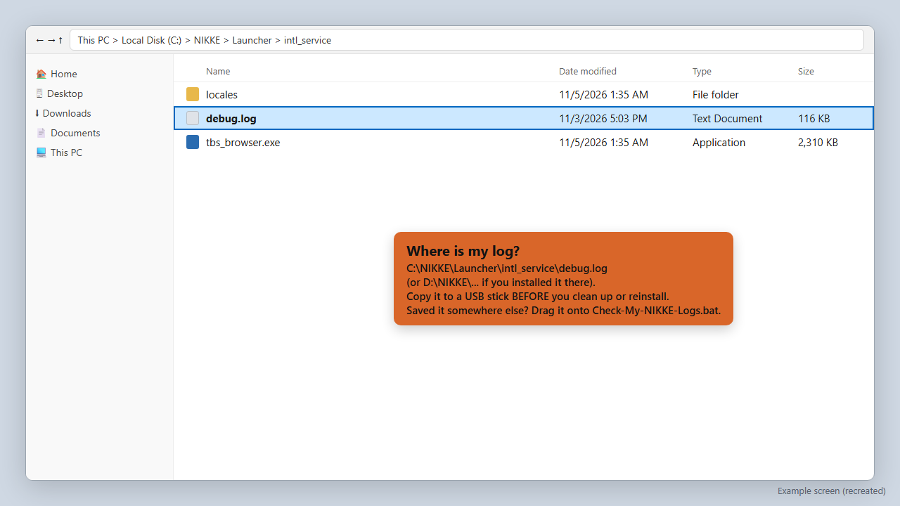
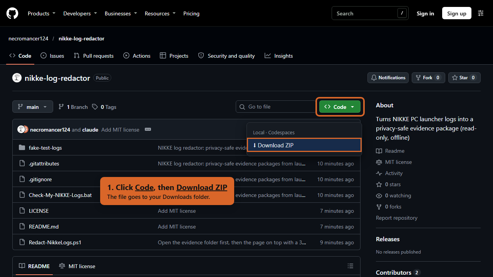
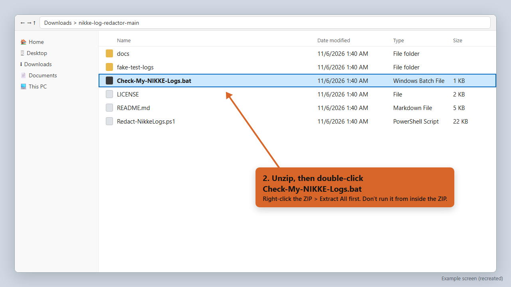
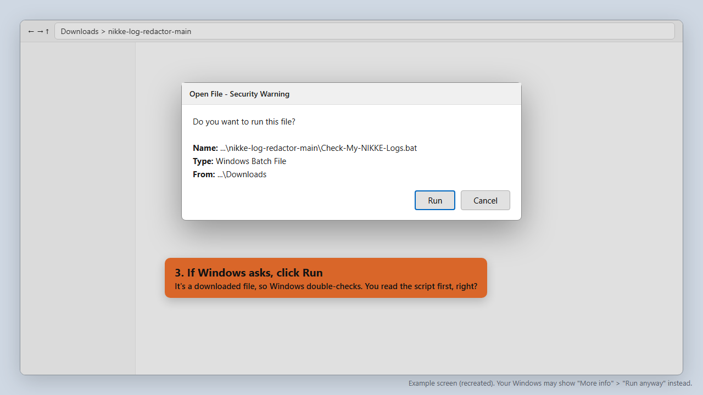
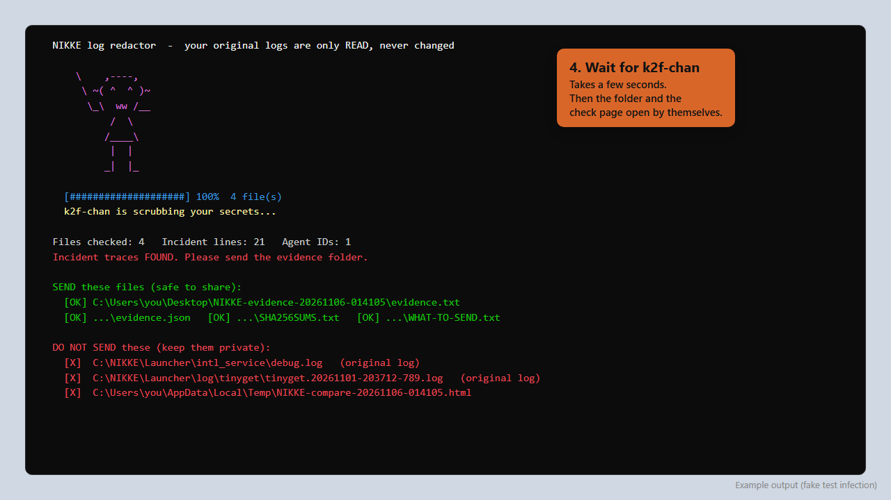
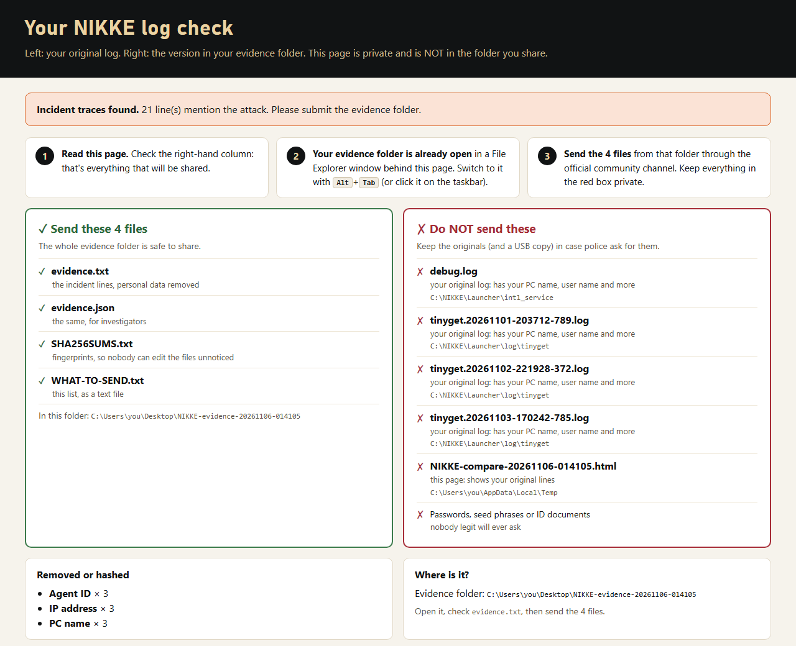
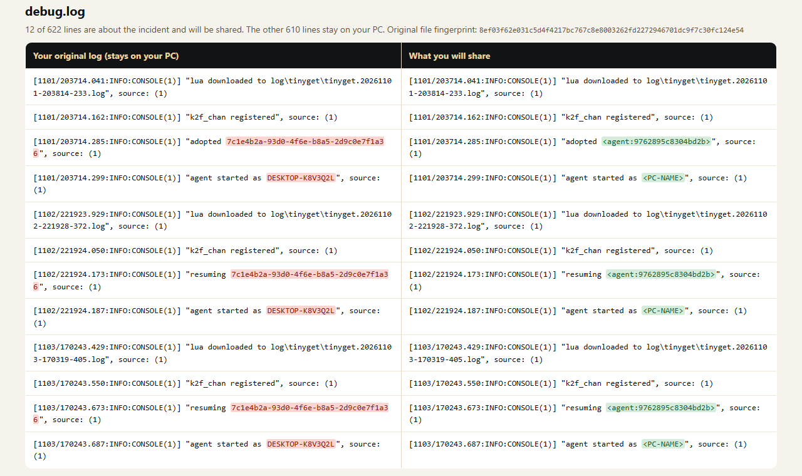
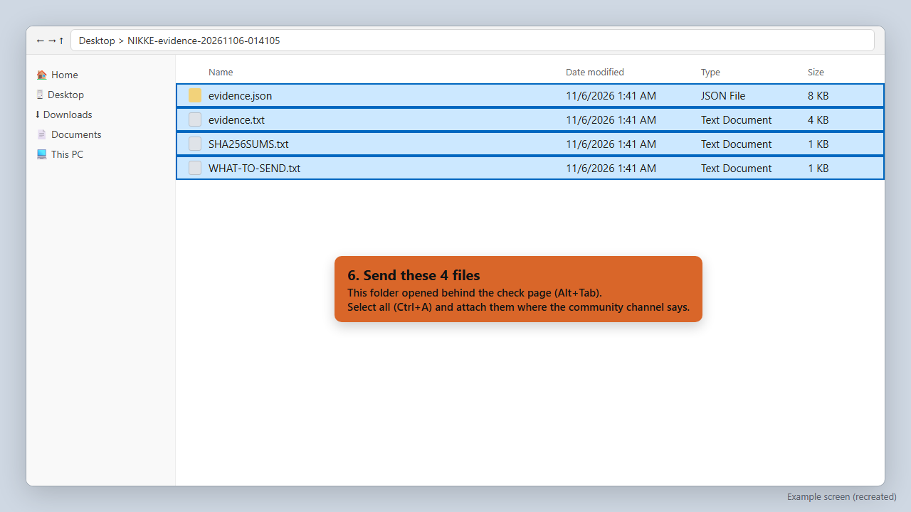
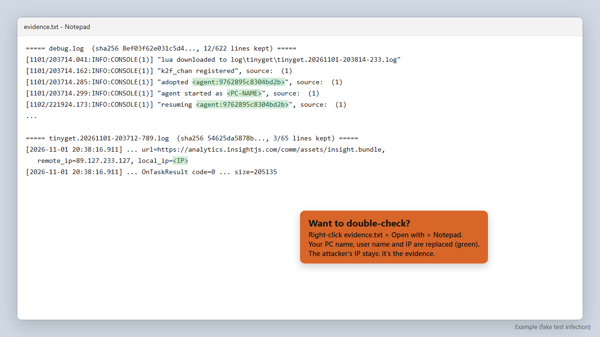

# Photo tutorial: check your NIKKE logs and send the evidence

About 5 minutes. No typing. Your original logs are only **read**, never changed.

> The screenshots use a **fake test infection** and example paths (`C:\Users\you\...`). Some screens are recreated so they don't show anyone's real PC. Yours will look a little different.

---

## Before you start: save your log

If you haven't cleaned up or reinstalled NIKKE yet, **copy your log first**. It's the evidence.

- It's here: `C:\NIKKE\Launcher\intl_service\debug.log` (or `D:\NIKKE\...` if you installed NIKKE on another drive).
- Copy it to a USB stick or another folder. **Copy, don't move.**
- Already reinstalled? Run the tool anyway. It will tell you if your current logs are clean.

---

## 1. Download the tool

On [github.com/necromancer124/nikke-log-redactor](https://github.com/necromancer124/nikke-log-redactor), click the green **Code** button, then **Download ZIP**.

---

## 2. Unzip it and double-click the launcher

1. Open your **Downloads** folder.
2. Right-click `nikke-log-redactor-main.zip`, choose **Extract All**, then **Extract**.
3. In the new folder, double-click **`Check-My-NIKKE-Logs.bat`**.

> Safety habit: before running any script during an attack, right-click `Redact-NikkeLogs.ps1` and choose **Open with > Notepad** to see what it does. It only reads files and writes a new folder.

**Saved your log somewhere else** (USB stick, backup folder)? Drag `debug.log`, or the whole folder, onto `Check-My-NIKKE-Logs.bat` instead of double-clicking.

---

## 3. If Windows asks, click Run

Windows double-checks files downloaded from the internet. Click **Run**. If you see a blue "Windows protected your PC" box instead, click **More info**, then **Run anyway**.

---

## 4. Wait for k2f-chan

It takes a few seconds. At the end, the window shows a green list (**send these**) and a red list (**don't send these**). Then two things open by themselves:
1. your **evidence folder** in File Explorer, and
2. the **check page** in your browser, on top of it.

---

## 5. Read the check page

At the top it tells you if anything was found:
- **Incident traces found** (red): your PC ran the malware. Please send the evidence.
- **No incident traces found** (green): nothing in these logs.
- **⚠ could not be read** (yellow): that file wasn't checked. Don't assume it's clean, and ask for help.

Below that: the **green box** lists the 4 files to send, the **red box** lists what to keep private.

Scroll down to compare line by line:
- **Left** is your original log, which stays on your PC. Personal values are in **red**.
- **Right** is what you'll send. The same values are replaced in **green**: `<PC-NAME>`, `<USER>`, `<IP>`, and `<agent:...>`, a fingerprint of the malware's ID for your PC.
- The attacker's address (`analytics.insightjs.com`, `89.127.233.127`) stays visible. That's the evidence.

This page is **private**. It is not in the folder you send.

---

## 6. Send the 4 files

Switch to the evidence folder (**Alt+Tab**, or click it on the taskbar). It's on your Desktop, named `NIKKE-evidence-<date>`.

| Send ✅ | Keep private ❌ |
|---|---|
| `evidence.txt` | your original `debug.log` and `tinyget*.log` files |
| `evidence.json` | the check page `NIKKE-compare-....html` |
| `SHA256SUMS.txt` | passwords, seed phrases, ID documents (nobody legit will ever ask) |
| `WHAT-TO-SEND.txt` | |

Select all 4 (**Ctrl+A**) and send them through the official community channel.

---

## Optional: look inside before sending

Right-click `evidence.txt`, choose **Open with > Notepad**. You'll see only the incident lines, with your personal values replaced.

---

## After sending

- **Keep your original logs** (and the USB copy) until this is over. Police may ask for the originals.
- If you were infected, **change your passwords from a different device**, sign out of all sessions, and turn on 2FA.
- If you hold crypto, move it to a new wallet created on a clean device.
- Use the official check guide to clean your PC: https://x.com/NIKKE_en/status/2118118928631451774
